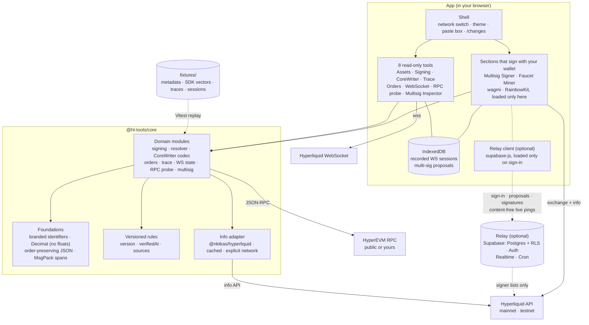

# hl-tools

**Understand and verify any Hyperliquid action.** Diagnostic tools for developers building on HyperCore and HyperEVM, live at [hltools.tech](https://hltools.tech).

Every diagnostic tool is read-only, works without a wallet and runs in your browser. Two sections sign with your own wallet and say so on their card: the Multisig Signer and the faucet miner. The Multisig Signer can also be run with an optional relay, so co-signers who sign in with their wallet see each other's proposals and signatures; what that stores is in the [Privacy Policy](https://hltools.tech/privacy). Pasted payloads and signatures are processed client-side and never put into a URL unless you explicitly share them. Every fetched result shows the network it came from and when it was observed, and identifiers never silently cross between mainnet and testnet.

All tools share one typed, decimal-safe protocol core, [`@hl-tools/core`](packages/hl-core). Its signing is checked byte for byte against the official Python SDK.

## Tools

| Tool | Answers | Route |
|---|---|---|
| **Asset Resolver** | *Why does `@107` mean HYPE on mainnet but nothing on testnet?* Says what you typed (`@` spot index, `#` outcome coin, `+` outcome token, `dex:` HIP-3, bare asset ID…), then every spelling of each identity with where it is used (info/WS coin, exchange `a`, token for balances and transfers, app-only display symbol), the same asset on other venues, and settled HIP-4 outcomes that have left `outcomeMeta`. Side by side across networks; ambiguous queries are never auto-resolved. | `/tools/assets` |
| **Signing Inspector** | *`L1 error: User or API Wallet 0x… does not exist.`* Shows the signing family, canonical MsgPack bytes, action hash, EIP-712 typed data and the recovered signer. Compare mode names the first divergent byte between two payloads. No private-key field. | `/tools/signing` |
| **CoreWriter Workbench** | *What does `0x01000001…` actually tell HyperCore to do?* Decodes or builds raw CoreWriter action bytes, with raw integers next to human units. Generates `cast` and Solidity, and queries all 19 read precompiles live. | `/tools/corewriter` |
| **Cross-layer Trace** (flagship) | *My EVM transaction succeeded — why did nothing happen on HyperCore?* Follows a HyperEVM transaction through its receipt and decoded CoreWriter actions to the expected and the observed HyperCore effect, and checks every EVM → Core token transfer (e.g. a `CoreDepositWallet.depositFor` payout) against the recipient's HyperCore ledger, so a silently dropped transfer is reported as such. Each link is labelled observed, inferred or unknown. | `/tools/trace` |
| **Order Composer & Failure Explainer** | *`Price must be divisible by tick size.`* Composes order payloads from intent, with a pre-flight tick/lot linter that blocks instead of silently rounding. Explains exchange responses status by status. | `/tools/orders` |
| **WebSocket Workbench** | *Did I miss messages while my socket was down?* Shows the subscription ack, snapshot and live stream with freshness. Simulates a disconnect and diffs state across the reconnect. Records bounded, sanitised sessions and replays them. | `/tools/websocket` |
| **RPC Capability Probe** | *Does this RPC return historical state or silently give me latest?* Checks chain ID, head freshness and historical state (with exact controls), plus `eth_getLogs` range limits and HyperEVM-specific methods, with a two-endpoint comparison. | `/tools/rpc` |
| **Multisig Inspector** | *Why does the chain say `Invalid multi-sig inner signer`?* Inspects a native multi-sig account — signers, threshold, approved API wallets (which act for the account without the multi-sig), balances, open orders, health flags, recent actions on demand — or decodes a multi-sig request body or proposal document: the action in plain words, every signature recovered and attributed, readiness against the live signer set, and the divergence that breaks a signature. Read-only; nothing is stored. | `/tools/multisig` |
| **Multisig Signer** | *How do two of three signers get one payment onto the chain?* Create a treasury by converting your own account into a multi-sig (who signs, how many must sign, one wallet prompt), then propose native multi-sig actions for it (USDC and spot sends, perps ↔ spot transfers, withdrawals, staking, vault deposits and withdrawals, approving and removing an API wallet, a switch between a manual and a unified account, a change of signers, or any other user-signed action as JSON), sign with your wallet, and let the chosen finaliser sign the envelope and submit. "Change signers" replaces the list and the number in one proposal, says what the change does to the proposals still waiting, and holds the guided "Convert back to a normal account". Sends are built as `sendAsset`, so they work for a treasury in manual or in unified account mode, go through in any order, and deliver the amount signed; the form says what a send costs (Hyperliquid charges 1 USDC for the first send to an address never used) and the page stops before submitting anything Hyperliquid would refuse. Staking is three forms named by where the HYPE ends up (Stake, Return to spot, Move to another validator): the form reads what is already there and makes one proposal or two, and two are shown, signed and submitted as one move, the second step sent only once Hyperliquid accepted the first. Every validator is listed as Hyperliquid reports it, with one amber line for one that pays nothing; none is recommended. A vault deposit or withdrawal names HLP or any vault by its address, shown as Hyperliquid reports it, and is one proposal or two (a manual account's USDC is moved to perps first). Hyperliquid has a vault action signed as a code under a network with chain id 1337, which no wallet holds: the page offers to add such a network to the wallet (one approval, nothing is ever sent on it), shows the code the wallet will show so the two can be compared, and puts the wallet back on its own network afterwards. A send to HyperEVM, which Hyperliquid refuses from a multi-sig, is stopped in the form. A form left half filled is kept in the browser for a week. Every signature is verified in your browser, readiness is judged against the live signer set, and the chain's answer is explained. Two ways to work together: pass the proposal on as a link or a file and merge what comes back, with nothing but a wallet; or, where a relay is configured, sign in with your wallet to see your treasuries, a "Needs you" inbox, signatures arriving live and each treasury's history. There, any signer can also say no to a proposal: an objection the others see, which ends nothing (only its proposer can withdraw a proposal). Signed in, a treasury page also shows what the account holds, live (balances, positions, open orders), its HYPE in staking (staked with whom, from when it can be unstaked, when a return lands; read once a minute), its USDC in vaults (what each deposit is worth and from when it can be withdrawn, read once a minute; and every vault deposit and withdrawal on Hyperliquid's record, tied to the proposal it came from where one agrees) and Hyperliquid's own record of it (transfers, trades, orders, funding), with each outgoing transfer tied to the proposal that caused it or marked "none on record"; "While you were away" tells a signer what was carried out or changed without them; signers can give addresses nicknames that are used only in that treasury; and a "?" next to every term explains it in plain words. Wherever a proposal reads as accepted, the page checks it against Hyperliquid's own record of the account and says so when no transaction is there. The Signing log and each table of Hyperliquid's record download as CSV (times in UTC). For someone new: a short "How this works" card, a glossary, and a way to look at any treasury without a wallet. No keys in the page. Signs & sends. | `/multisig` |
| **Testnet Faucet Miner** | *How do I get more than one faucet drip of testnet USDC?* The original hl-tools utility. It signs and sends: it chains generated wallets through the testnet faucet using your connected wallet. [How it works](https://hltools.tech/faucet-miner/how-to-use). | `/faucet-miner` |

Each tool page shows the date its rules were last verified against the protocol docs and links its primary source. [`/changes`](https://hltools.tech/changes) lists every versioned rule set with its sources and changelog.

## Architecture



- **`packages/hl-core`** holds the protocol logic, with no React and no DOM. Its versioned rules also drive the "last verified" dates on tool pages and the `/changes` page. Network access is injected, so traces, probes and sessions replay from recorded fixtures in tests.
- **`src/`** is the app: file-based routes in `src/routes/`, tool UIs in `src/components/tools/`, the Multisig Signer in `src/components/multisig/` (screens over a pure, tested model), and the shared design system in `src/components/hub/`.
- **`supabase/`** is the optional relay for the Multisig Signer: hand-written migrations (tables with row-level security, the look-up worker, live pings, schedules) and their pgTAP tests. It stores and gates; it is never trusted. Every browser verifies each document and signature itself and judges readiness against the chain, so a relay can delay or hide but cannot forge or move funds. With its two environment variables unset, the app does not contain a sign-in at all.
- **Live account data** comes straight from Hyperliquid to the browser: one WebSocket per network for the treasury on screen (the core's `ws/hub.ts`), a few HTTP reads a minute for its signers, API wallets and account mode, and for its staking and vault figures while those are shown, two reads about an address a send names (is it new, and its mode), and the explorer only to tie a transfer to a proposal (one request for the account's newest transactions; a single transaction only when that list cannot have it); and for the "while you were away" notice, the transfers of each of the wallet's treasuries since it was last marked read, at most once in five minutes. None of it passes through the relay or is stored.
- **Browser storage.** IndexedDB holds recorded WebSocket sessions and the multi-sig proposals you made or opened. It is this browser's memory, not chain data: a proposal exists for the chain only once it is submitted, and the document (link, file or the relay's copy) is the whole proposal. localStorage holds preferences (network, theme, treasuries hidden or named in this browser), the sessions of the wallets signed in to a relay, and, under `hl-tools:multisig-drafts`, what was typed into a Multisig form and not yet created (one draft per treasury, the newest twenty, for a week).
- **The signing network.** A vault action is signed as a code under chain id 1337. The network the wallet adds for that points at a stand-in ([`src/lib/signingRpc.ts`](src/lib/signingRpc.ts)) that answers which chain it is, a block number and zero balances, refuses every transaction and keeps nothing. A build without `VITE_CHAIN_1337_RPC_URL` has no vault forms.
- Why things are built the way they are: [DECISIONS.md](DECISIONS.md). What was tested, with which inputs, plus screenshots of every page: [TESTING.md](TESTING.md).

## Run it

Requires [Bun](https://bun.sh) (or Node 22+ for the production server).

```bash
git clone https://github.com/ashwinarora/hl-tools.git
cd hl-tools
bun install
bun --bun run dev        # http://localhost:3000
```

The diagnostic tools and the Multisig Signer need no configuration (the signer's wallet picker offers only the wallets in the browser). The WalletConnect-based wallets in the faucet miner's wallet picker need a project ID in `.env` (from [cloud.walletconnect.com](https://cloud.walletconnect.com/)):

```
VITE_WALLETCONNECT_PROJECT_ID=your_walletconnect_project_id
```

| Command | What it does |
|---|---|
| `bun --bun run dev` | Dev server on port 3000 |
| `bun --bun run build` | Production build into `.output/` |
| `bun --bun run start` | Serve the production build (`node .output/server/index.mjs`) |
| `bun --bun run test` | Vitest: protocol core and the app's pure logic (3,335 tests) |
| `bun --bun run check` | Biome lint + format check |
| `bun run db:start` / `db:stop` | Start or stop the local relay (Supabase CLI and Docker) |
| `bun run db:reset` | Rebuild the local relay database from `supabase/migrations/` |
| `bun run db:test` | pgTAP: the relay's access rules, guards and worker (1,015 assertions) |
| `bun run test:relay` | Integration tests of the relay client against the local stack (78 tests) |
| `bun run rpc:1337` | Serve the signing network's stand-in on `http://localhost:3337/rpc` (for vault forms) |

### Run your own relay (optional)

The Multisig Signer works without it. To try the signed-in side locally you need Docker and the [Supabase CLI](https://supabase.com/docs/guides/local-development/cli/getting-started):

```bash
bun run db:start         # prints the API URL and the publishable key
```

Put the two values in `.env` and restart the dev server:

```
VITE_SUPABASE_URL=http://127.0.0.1:54321
VITE_SUPABASE_PUBLISHABLE_KEY=sb_publishable_…
```

Open the app as `http://localhost:3000`, not `127.0.0.1`: signing in with a wallet names the site, and an IP address is refused. `bun run db:reset` rebuilds the database from the migrations; `bun run db:test` and `bun run test:relay` check it.

### Vault forms (optional)

Vault deposits and withdrawals in the Multisig Signer are signed as a code under chain id 1337, and a wallet signs one only while it is on a network with that id. Serve the stand-in and name its link in `.env`, then restart the dev server:

```bash
bun run rpc:1337         # http://localhost:3337/rpc
```

```
VITE_CHAIN_1337_RPC_URL=http://localhost:3337/rpc
```

The page then offers "Add the signing network" where a vault action is signed. Without the line the vault forms are absent, and a vault proposal that arrives as a link or a file can be read and checked but not signed.

Dev-only helpers: `?devtools=1` shows the TanStack devtools, and `/faucet-miner?mock=1` runs the faucet miner against an MSW mock of the Hyperliquid API, so no funds move.

## Contributing fixtures

Every bug found in a browser should become a fixture, so the core never regresses on it. Fixtures live in [`packages/hl-core/fixtures/`](packages/hl-core/fixtures). Most are data-only, and a new case is picked up by the existing tests.

| Fixture | Add a case when… | Format |
|---|---|---|
| `resolver/cases.json` | a query resolves wrongly or explains badly | `{ network, query, first, ambiguous, includes, matches, noteIncludes, expect, bug? }`, resolved against `metadata/<network>.json` |
| `orders/lint-cases.json` | a price/size is accepted, rejected or rounded wrongly | `{ coin, input, valid, wire, options, note }` under `price` / `size` |
| `orders/explain-cases.json` | an exchange response or error is explained wrongly | `{ name, input, request?, kind, outcomes, bug? }` |
| `corewriter/cases.json` | CoreWriter bytes decode wrongly | `{ name, network, hex, kind, action, fields, issueCodes }` (real payloads preferred) |
| `signing/python-sdk-vectors.json` | a signing case isn't covered | regenerate with `scripts/gen_signing_vectors.py` from a checkout of `hyperliquid-python-sdk`; never hand-edit |
| `signing/python-sdk-multisig-vectors.json` | a multi-sig signing case isn't covered | `uv run --with hyperliquid-python-sdk python packages/hl-core/scripts/gen_multisig_vectors.py > …`; never hand-edit |
| `multisig/lab-envelopes.json` | a real multi-sig request behaves unexpectedly | record it with the lab harness (`labs/multisig`, gitignored), then `bun packages/hl-core/scripts/extract_lab_envelopes.ts`; public data only |
| `multisig/send-order.json` | Hyperliquid takes or refuses actions in an order the core does not predict | pairs of real requests, newer nonce first: `{ label, first: { action, leader, nonce, answer }, then: {…} }`; recorded with the lab harness, public data only; `test/multisig/order.test.ts` replays every pair |
| `multisig/nonce-order.json` | Hyperliquid refuses (or takes) an action because of its number in a way the core does not predict, or a refused request turns out to be retryable | the order lab: `{ suite, account, label, before?, steps: [{ action, nonce, leader?, answer }] }`, 247 questions put to a plain account and to a multi-sig on testnet, in the order they were sent; `test/multisig/order.test.ts` replays every one |
| `multisig/send-modes.json` | a way of sending is refused or accepted in an account mode, or lands in a balance, other than the core predicts | the mode matrix: `{ sends: [{ about, senderMode, senderIs, receiverMode, toItself, action, answer, senderChange, receiverChange }], switches: [{ from, to, reported, before, after }] }`, 78 sends on testnet across three sender modes, three receiver modes and six ways of moving money, plain accounts and a multi-sig; `test/multisig/transfer.test.ts` replays every one |
| `multisig/activation-fee.json` | a send to an address never used (or to one in use) is charged differently from what the core predicts | `{ sends: [{ about, senderMode, senderIs, action, receiverWas, senderHeld, answer, senderChange, receiverChange, ledgerFee }] }`, 49 sends on testnet; replayed by the same test |
| `multisig/self-send.json` | a send from an account to itself is refused or taken differently from what the core predicts | `{ sends: [{ about, account, action, answer }] }`, 8 sends on testnet; `test/multisig/transfer.test.ts` replays every one |
| `multisig/agent-reach.json` | an API wallet can or cannot do something other than the core says | `{ runs: [{ about, account, action, answer }] }`, 11 requests signed by an API wallet of a plain account and of a multi-sig; replayed by `test/multisig/agentReach.test.ts` |
| `multisig/plain-convert.json` | a conversion signed by the account itself is refused or accepted differently, or its signature does not recover to the account | `{ conversions: [{ about, account, action, signature, answer, signer? }] }`, 12 conversions on testnet under five signing chains; `test/multisig/plain.test.ts` recovers every one and rebuilds it key for key |
| `multisig/staking.json` | a staking action is refused or accepted, or leaves the account in a state, other than the core predicts | `{ network, validators, notes, steps: [{ about, action, sentAt, before, answer, after, history }] }`, 18 staking actions through a multi-sig on testnet in the order they were sent, with what Hyperliquid reported before and after each; `test/multisig/staking.test.ts` replays every one |
| `multisig/vaults.json` | a vault deposit or withdrawal is refused or accepted, or leaves the account in a state, other than the core predicts | `{ network, accounts, vaults, notes, steps: [{ about, account, action, sentAt, before, answer, after, ledger }] }`, 17 requests through multi-sigs on testnet (a unified and a manual treasury, every refusal, the lockup from both sides); `test/multisig/vault.test.ts` replays every one |
| `multisig/mode-switch.json` | a switch between a manual and a unified account through a multi-sig is hashed, refused or accepted differently | `{ hashedAs, requests: [{ about, request, hashedAbstraction, answer }], switches: [{ about, account, before, request, hashedAbstraction, answer, after }] }`, each request exactly as posted; `test/multisig/modeSwitch.test.ts` recovers the finaliser from every one |
| `multisig/inner-form.json` | Hyperliquid judges a multi-sig request's signatures over another writing of the inner action than this one | `{ account, policy, requests: [{ about, posted, innerSignedOver, outerSignedOver, request, answer }] }`, each request exactly as posted; `test/multisig/innerForm.test.ts` predicts every answer |
| `multisig/evm-transfer.json` | a send from a multi-sig to a HyperEVM system address is answered differently | `{ account, tokens, sends: [{ about, action, answer }] }`, 7 sends on testnet; replayed by `test/multisig/transfer.test.ts` |
| `multisig/agent-unnamed.json` | an API wallet without a name is listed, approved or removed differently | `{ account, steps: [{ about, action, answer, after }] }`, `after` being what `extraAgents` and `webData3` then reported; replayed by `test/multisig/account.test.ts` |
| `explorer/testnet-userdetails.json` | the explorer's list of an account's newest transactions is read wrongly, or its size or paging changes | `{ answers: [{ name, user, status, returned, body }] }`, the answers to `userDetails` as received (for the lab treasury a slice of the 300, each entry untouched); read back by `test/explorer.test.ts` |
| `explorer/<name>.json` | a transaction look-up is read wrongly | the explorer's answers as received (found, unknown hash, malformed, the day's allowance used up), for `test/explorer.test.ts` |
| `src/samples/multisig.ts` (core) | the Multisig Inspector needs another sample | copy a recording from `multisig/lab-envelopes.json` by its label; never hand-edit a body (the signatures must keep recovering to the lab wallets) |
| `trace/<name>.json` | a transaction traces wrongly | `bun packages/hl-core/scripts/record_trace.ts <name> <network> <txHash>`, then add an assertion in `test/corewriter.test.ts` |
| `ws/<name>.json` | WebSocket state handling is wrong | `bun packages/hl-core/scripts/record_ws.ts <name> <network> <seconds> '<subscription json>'` |
| `metadata/<network>.json` | the resolver needs newer metadata | `python3 packages/hl-core/scripts/snapshot_metadata.py` (then re-run the tests; update cases that legitimately changed) |

Then run `bun --bun run test` and `bun --bun run check`. If a rule changed (a limit, a unit, an error string), bump its rule set's `version` and `verifiedAt` in `packages/hl-core/src/rules/` and add a changelog entry. `/changes` picks it up automatically.

## Stack

TanStack Start (React 19, SSR, Nitro) · TanStack Router and Query · Zustand · Tailwind CSS v4 with shadcn/ui primitives · viem · `@nktkas/hyperliquid` · wagmi and RainbowKit (Multisig Signer and faucet miner only) · Supabase (Postgres, Auth, Realtime, Cron) for the optional relay · Vitest and pgTAP · Biome · TypeScript strict.

## Disclaimer

Independent open-source project, not affiliated with Hyperliquid. The diagnostic tools are read-only. The Multisig Signer submits to Hyperliquid, from your browser, exactly what you and your co-signers sign with your own wallets: read every action in the wallet prompt before approving it, and rehearse on testnet first. The faucet miner sends funds directly to Hyperliquid on your behalf from your own wallet. Use both at your own discretion.

## License

MIT
